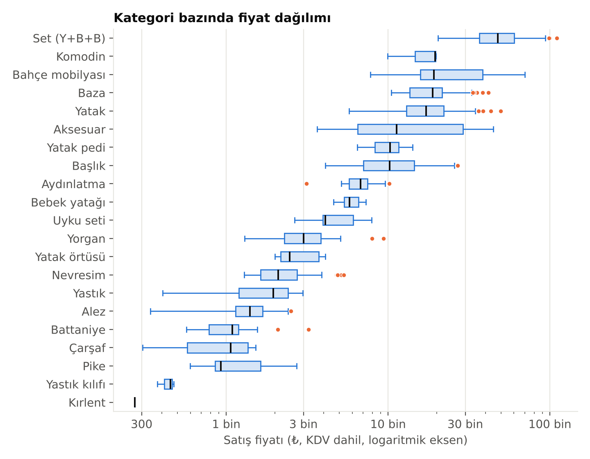
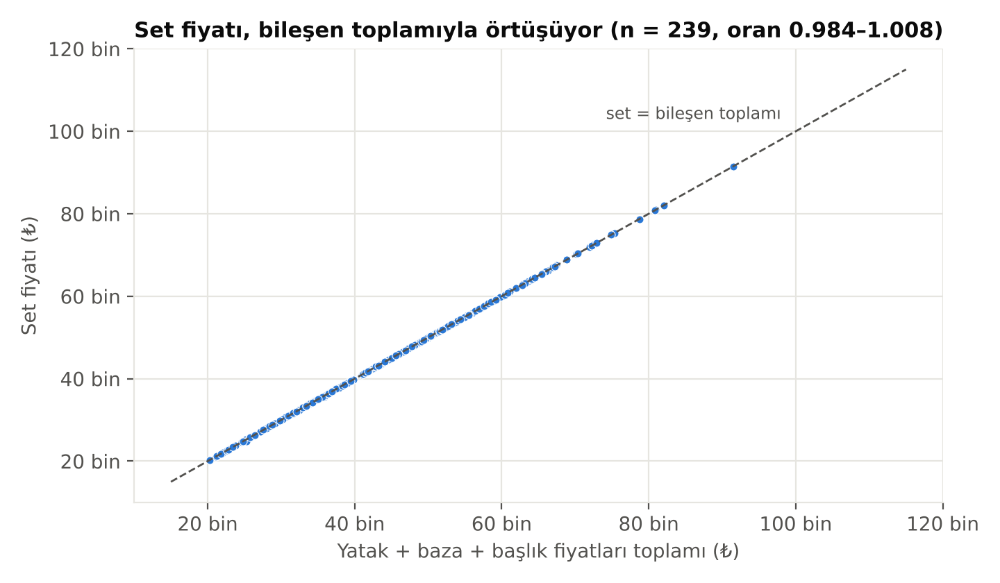

# SmartCost ERP & B2B – Veri Seti

**Üretim İşletmeleri İçin Yapay Zekâ Destekli Otomatik Maliyetlendirme ve Satış Teklifi Oluşturma Sistemi**
İstanbul Gedik Üniversitesi · Bilgisayar Mühendisliği · MFK420 Mezuniyet Projesi ve Tezi (2026)
Proje ekibi: Yasin Almaz, Sümeyra Melike Aslan, Nisa Sude Kahraman · Danışman: Dr. Öğr. Üyesi Hikmet Canlı

Bu veri seti SmartCost B2B teklif sisteminin iki temel bileşenini besler:

| Bileşen | İçerik | Boyut |
|---|---|---|
| **Ürün kataloğu** | Gerçek perakende fiyat listelerinden derlenmiş yatak, baza, başlık, set ve ev tekstili ürünleri | 1.434 ürün–ebat satırı · 291 model · 21 kategori |
| **Sipariş cümleleri** | Serbest metinle yazılmış, ürün ve adet düzeyinde etiketli sentetik B2B müşteri talepleri | 1.000 cümle · 2.137 etiketli kalem |

---

## Klasör yapısı

```
SmartCost_ERP_B2B_Veri_Seti/
├── README.md                          bu dosya (veri kartı ve veri sözlüğü)
├── veri/
│   ├── urun_katalogu.csv              ana ürün ve fiyat tablosu
│   ├── urun_ozellikleri.csv           türetilmiş sayısal/kategorik özellikler
│   ├── set_bilesen_karsilastirma.csv  set fiyatı ile yatak+baza+başlık toplamı
│   └── siparis_cumleleri/
│       ├── train.csv / train.jsonl    eğitim (600 cümle)
│       ├── val.csv   / val.jsonl      doğrulama (200 cümle)
│       ├── test.csv  / test.jsonl     test (200 cümle, 40'ı yazım hatalı)
│       ├── etiketler_uzun.csv         her satır bir kalem (cümle_id, sıra, urun_id, adet)
│       └── bolum_modelleri.csv        hangi modelin hangi bölüme ayrıldığı
├── istatistikler/
│   ├── kesifsel_analiz_ozeti.json     eksik/aykırı/tutarsızlık ve ilişki analizleri
│   └── baseline_nlp_sonuclari.json    kural tabanlı ayrıştırıcının başarımı
├── gorseller/                         keşifsel analiz grafikleri
└── betikler/
    ├── veri_seti_uret.py              sipariş cümlelerini yeniden üretir (sabit tohum 2026)
    └── dogrula.py                     bütünlük kontrolleri
```

Tüm CSV dosyaları **UTF-8 (BOM'lu)** kaydedilmiştir; Excel'de Türkçe karakterler doğru açılır. Ondalık ayırıcı noktadır (`11886.14`).

---

## 1. Ürün kataloğu (`veri/urun_katalogu.csv`)

### Kaynak

Bambi Yatak'ın kamuya dağıtılan iki **Tavsiye Edilen Perakende Fiyat Listesi** (fiyat değişim tarihi **07.10.2026**):

| Liste | Biçim | Derleme yöntemi | Satır |
|---|---|---|---|
| Yatak – Baza – Başlık – Set (+ bebek yatağı, ped, mobilya, aydınlatma, aksesuar) | 6 sayfa taranmış görüntü | Elle aktarım + otomatik monotonluk doğrulaması | 1.230 |
| Ev Tekstili (alez, çarşaf, pike, yastık, yorgan, nevresim, battaniye ...) | 6 sayfa metin tabanlı PDF | Metin çıkarma + düzenli ifadelerle ayrıştırma | 204 |

### Veri sözlüğü

| Sütun | Tip | Açıklama |
|---|---|---|
| `urun_id` | int | Benzersiz ürün–ebat kimliği (sistem veritabanıyla aynı) |
| `kategori_kodu` | str | Sistem kodu: `YATAK`, `BAZA`, `BASLIK`, `SET`, `YASTIK` ... |
| `kategori` | str | Türkçe kategori adı |
| `model` | str | Model/seri adı; aynı modelin ebatları aynı değeri taşır |
| `ebat` | str | `160x200` (en×boy cm), `160` (başlık genişliği), `TEK KISILIK` / `CIFT KISILIK` / `BATTAL` ya da boş |
| `ebat_turu` | str | `en_x_boy`, `genislik`, `kisilik_sinifi`, `yok` |
| `en_cm`, `boy_cm` | int | Ebattan ayrıştırılmış ölçüler (yoksa boş) |
| `urun_adi` | str | Tam ürün adı |
| `liste_fiyati_tl` | float | Liste fiyatı, ₺ |
| `kampanyali_fiyat_tl` | float | Kampanyalı fiyat (yalnız 6 üründe, %60 indirim) |
| `satis_fiyati_tl` | float | Geçerli fiyat = kampanyalı varsa o, yoksa liste fiyatı |
| `kdv_dahil` | str | Liste fiyatlarına KDV dahildir (`evet`; ev tekstili listesinde %10) |
| `baslangic_stok` | int | Sentetik başlangıç stoğu (her ürün 50) |
| `kaynak_liste` | str | Satırın alındığı liste |
| `fiyat_tarihi` | date | 2026-10-07 |

### Kategori özeti

| Kategori | Satır | Model | Fiyat aralığı (₺) |
|---|---:|---:|---|
| Başlık | 312 | 28 | 4.099 – 26.925 |
| Yatak+Baza+Başlık Seti | 305 | 35 | 20.319 – 110.026 |
| Baza | 277 | 32 | 10.493 – 41.627 |
| Yatak | 249 | 29 | 5.728 – 49.733 |
| Nevresim | 44 | 24 | 1.292 – 5.319 |
| Alez | 41 | 10 | 340 – 2.514 |
| Yorgan | 29 | 13 | 1.302 – 9.392 |
| Yastık | 24 | 24 | 404 – 2.971 |
| Bahçe Mobilyası | 22 | 22 | 7.779 – 69.904 |
| Battaniye | 20 | 13 | 567 – 3.216 |
| Yatak Pedi | 18 | 2 | 6.441 – 14.174 |
| Bebek Yatağı | 16 | 4 | 4.609 – 7.275 |
| Aydınlatma / Aksesuar / Çarşaf | 14'er | 14 / 14 / 3 | 304 – 44.633 |
| Pike / Uyku Seti | 11'er | 7 / 6 | 599 – 7.932 |
| Yatak Örtüsü, Komodin, Yastık Kılıfı, Kırlent | 6 / 3 / 3 / 1 | – | 272 – 19.720 |



### Kalite kontrolleri

- Eksik fiyat, sıfır/negatif fiyat ve tekrar eden kayıt **yok**.
- 80 ürünün ebatı yapısal olarak yoktur (yastık, mobilya, aydınlatma, aksesuar); eksik veri değildir.
- Ebat–fiyat monotonluğu: aynı modelde ebat büyüdükçe fiyat düşmemeli → **708 çiftte 0 ihlal**.
- Set fiyatlarının **235/239**'u yatak + baza + başlık fiyat toplamına ±1 ₺ içinde eşittir (paket indirimi yok). 4 sapma kaynak listede de aynen bulunduğundan değiştirilmemiştir: COMFORT BALANCE-S SET 90x190 ve 150x200, OVIEDO-S SET 180x200, PINEDA-S SET 180x200 (`set_bilesen_karsilastirma.csv`).
- Standartlaştırmalar: ebat yazımı (100X200 → 100x200), kişilik kısaltmaları (TK/CK/ÇK/BT), Türkçe karakter tutarsızlıkları (DOĞAL/DOGAL), iki satıra bölünmüş ürün adı.



---

## 2. Sipariş cümleleri (`veri/siparis_cumleleri/`)

Gerçek müşteri talebi kullanılmadan, NLP ayrıştırıcısını ölçmek için üretilmiş **etiketli sentetik** veri. Her cümlede katalogdan seçilmiş 1–4 ürün; farklı ebat yazımları, adet kalıpları, bağlaçlar, selamlama/kapanış ifadeleri ve harf biçimleri bulunur.

```json
{"cumle_id": 802, "bolum": "test", "yazim_hatali": false,
 "metin": "thermo control beyaz/antrasit baza 200 X 200 ölçüsünde 15 adet bir de 140X190 Cm Kapali Baza 10 Tane",
 "kalemler": [{"urun_id": 421, "adet": 15, "urun_adi": "THERMO CONTROL BEYAZ/ANTRASIT BAZA 200x200"},
              {"urun_id": 609, "adet": 10, "urun_adi": "KAPALI BAZA 140x190"}]}
```

### Bölümler ve sızıntı önlemleri

| Bölüm | Cümle | Kalem | Model | Cümle kalıpları | Yazım hatası |
|---|---:|---:|---:|---|---|
| train | 600 | 1.301 | 174 | geliştirme kalıpları | yok |
| val | 200 | 416 | 58 | geliştirme kalıpları | yok |
| test | 200 | 420 | 59 | **yalnız teste özgü** kalıplar | 40 cümle (%20) |

- **Model bazlı ayrım:** Bir modelin hiçbir ebadı iki bölümde birden yer almaz (`bolum_modelleri.csv`).
- **Kalıp bazlı ayrım:** Test cümleleri geliştirmede kullanılmayan yazım biçimleri içerir (`x25`, `ölçüsünde`, `ad.`, `90*200`, satır sonu / `ile` / `bir de` bağlaçları).
- Bölümler arasında ortak cümle yoktur; kalem sayısı dağılımı: 1 kalem 305, 2 kalem 337, 3 kalem 274, 4 kalem 84.

### Etiket biçimleri

| Dosya | Biçim | Kullanım |
|---|---|---|
| `*.jsonl` | cümle başına bir JSON nesnesi, `kalemler` listesiyle | Python / NLP kütüphaneleri |
| `*.csv` | `cumle_id, yazim_hatali, kalem_sayisi, metin, etiket_json` | Excel, pandas |
| `etiketler_uzun.csv` | kalem başına bir satır | SQL/pandas birleştirme (`urun_id` → katalog) |

### Baseline sonuçları (kural tabanlı ayrıştırıcı)

| Bölüm | Kesinlik | Duyarlılık | F1 | Cümle tam eşleşme |
|---|---:|---:|---:|---:|
| val | %99,8 | %97,4 | **%98,5** | %94,5 |
| test (tümü) | %85,7 | %84,3 | **%85,0** | %72,0 |
| test – temiz | %90,2 | %91,0 | %90,6 | %81,2 |
| test – yazım hatalı | %66,2 | %58,6 | %62,2 | %35,0 |

Bir kalem, hem `urun_id` hem `adet` doğruysa doğru sayılır. Test kümesi bilinçli olarak zorlaştırılmıştır; ayrıntılı hata analizi Hafta 5 raporundadır.

---

## Kullanım

```python
import pandas as pd, json

katalog = pd.read_csv("veri/urun_katalogu.csv")
test = [json.loads(s) for s in open("veri/siparis_cumleleri/test.jsonl", encoding="utf-8")]

# kalemleri katalogla birleştirme
kalemler = pd.read_csv("veri/siparis_cumleleri/etiketler_uzun.csv")
kalemler = kalemler.merge(katalog[["urun_id", "kategori", "satis_fiyati_tl"]], on="urun_id")
```

Bütünlük kontrolü ve yeniden üretim:

```bash
python betikler/dogrula.py                       # tüm kontroller "OK" olmalı
python betikler/veri_seti_uret.py yeniden.csv    # aynı 1.000 cümleyi birebir üretir
```

---

## Sınırlamalar

- Fiyatlar tek bir üreticinin **perakende** liste fiyatlarıdır; gerçek bir üretim işletmesinin hammadde maliyetlerini temsil etmez. Sistem bu fiyatları birim maliyet (BF_i) olarak kullanır.
- Stok, müşteri ve sipariş bilgileri sentetiktir; gerçek talep dağılımını yansıtmaz.
- Sipariş cümleleri şablonlardan üretilmiştir; gerçek müşteri dilindeki çeşitliliğin tamamını kapsamaz.
- Operasyon (%15) ve kâr (%20) oranları proje varsayımıdır.

## Gizlilik ve kullanım

Veri setinde kişisel veri **bulunmaz**. Fiyatlar kamuya dağıtılmış listelerden alınmıştır; marka ve ürün adları ilgili firmaya aittir. Veri seti yalnızca **akademik ve eğitim amaçlı** paylaşılmaktadır, ticari kullanım için uygun değildir.

## Atıf

```
Almaz, Y., Aslan, S. M., Kahraman, N. S. (2026). SmartCost ERP & B2B Veri Seti:
Etiketli B2B sipariş cümleleri ve yatak–ev tekstili ürün kataloğu.
İstanbul Gedik Üniversitesi, Bilgisayar Mühendisliği Bölümü, MFK420 Mezuniyet Projesi.
```
